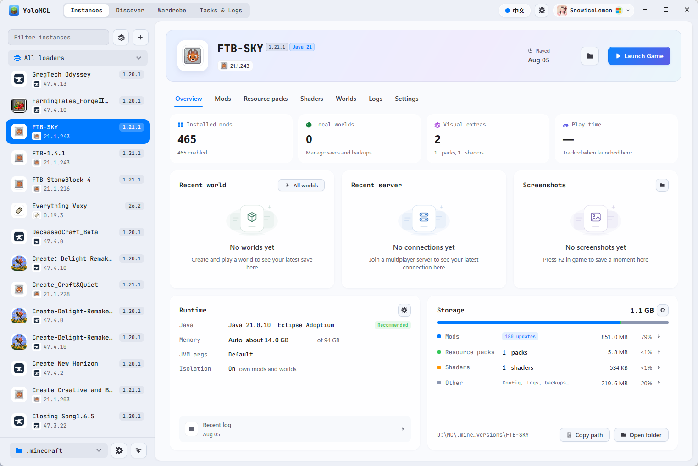
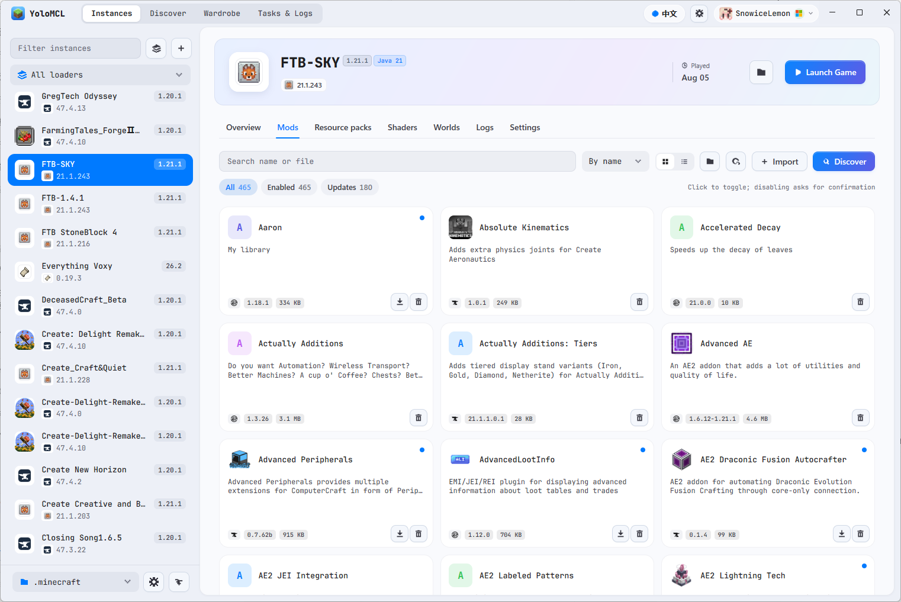
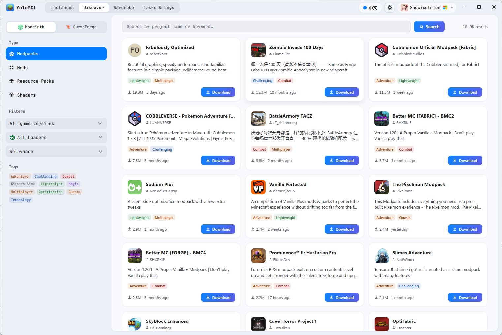

<p align="center"></p>

# YoloMCL

[English (primary)](../README.md) / [下载正式版](https://github.com/Viking602/YoloMCL/releases/latest) / [开发规范](CONTRIBUTING.md) / [项目架构](architecture.md) / [发布与在线更新说明](releases.md)

YoloMCL（应用内简称 MCL）是一个用 Go 编写的 Minecraft: Java 版启动器。界面基于 [MyGo](https://github.com/egoist/mygo) 的原生 UI（`mygo/ui`），没有 HTML、WebView 或本地网页服务，支持 Windows、macOS 和 Linux。

## 界面预览

### 实例概览



### 模组管理



### 资源发现



## 功能

- **跨平台原生界面**：标题栏按平台适配（macOS 使用系统红绿灯，位于左侧；Windows/Linux 标题栏与顶部导航合并）；任意窗口尺寸与 DPI 下不失真缩放；自然的页面动效与悬浮滚动条；中英双语默认跟随系统语言，也可在设置中手动选择。Windows 读取显示语言，macOS 读取首选语言顺序，Linux 读取 `LANGUAGE`、`LC_ALL`、`LC_MESSAGES`、`LANG`；未匹配到支持的语言时使用 English。
- **内置字体**：附带 JetBrains Mono，中文按系统回退到对应 CJK 字体。
- **游戏目录**：按平台自动识别默认 `.minecraft` 目录，可添加、切换、改名多个目录，每个目录可单独设置 Java 与内存。
- **版本安装**：从 Mojang 获取完整版本清单（正式版、快照/预发布、历史 Beta/Alpha），按官方哈希校验；支持 Fabric、Quilt 以及 Forge / NeoForge 官方安装器。默认版本名包含版本号与加载器版本，导入的整合包使用整合包自身名称；版本名右上角以小标签显示 MC 版本与加载器。
- **Java**：首帧呈现后在后台检测系统 Java 安装目录、JAVA_HOME/PATH、系统登记位置、已记录路径，以及整合包和启动器内的运行时；实例切换与设置页复用本次检测结果，可手动重新扫描、选择或下载 Temurin。Java 检测独立于整合包内容扫描，不遍历整块磁盘。
- **启动与内存**：实例清单持久缓存、后台按需验证，实例列表只构建可见行。启动器在创建窗口前加载配置并选择渲染方式，直接使用 MyGo 的窗口与界面入口。Windows 默认使用低内存软件渲染，保留界面动画；可在设置中开启界面硬件加速，重启启动器后生效，不影响 Minecraft 的渲染方式。MyGo 依赖源码保持原样。
- **内存**：读取系统物理内存，支持自动分配内存，也可手动设置。
- **资源与整合包**：在 Modrinth / CurseForge 搜索、下载模组与整合包并处理必需依赖；导入 `.mrpack` 与 CurseForge `.zip` 整合包，支持拖放导入。
- **整合包导出**：在实例的「设置 → 导出整合包」中选择 Modrinth `.mrpack` 或 CurseForge `.zip`，填写名称和版本，勾选要包含的文件与目录，再选择保存位置。任务页提供进度、取消和「查看导出文件」。
- **整合包更新**：检测新版本并展示改动列表；更新时保留玩家自己添加的模组和存档，整合包自带的配置文件始终覆盖为新版本，被覆盖的文件会先备份。
- **模组管理**：导入 JAR、启用/停用、移除前备份。
- **账号**：离线账号；Microsoft 正版登录（设备代码流程，Xbox / XSTS / Minecraft 档案，令牌刷新）；第三方 Yggdrasil / authlib-injector 认证服务器。
- **角色外观**：皮肤预览，上传皮肤与切换披风。
- **启动器更新**：每次启动后检查一次稳定版更新，下载前可确认或取消；支持发布者配置并签名的最低版本策略，用于要求安全更新。安装包校验签名，安装后由用户确认重启。配置方式与兼容限制见[发布说明](releases.md#require-a-security-update)。

导出使用当前所选实例的 Minecraft、加载器版本及其独立目录。默认包含模组、配置与脚本，存档、截图、服务器列表和个人选项需手动勾选；不包含启动器账号、运行环境、游戏依赖、日志与缓存。已识别并校验一致的文件使用平台下载引用，本地、已修改或未识别的文件放入 `overrides/`，禁用模组保留禁用状态。来源查询失败时，未识别文件仍会随包打包。归档逐个文件流式写入，取消或失败不会覆盖已有导出文件；保存位置需在游戏目录之外。

## 构建

需要 Go 1.27.3（见 `go.mod`）、GNU Make 和 Bash。检查和签名发布还需要 OpenSSL 3、tar/gzip/zip（Windows 的 ZIP 使用系统自带 tar）。配置解析、编译和打包都由 Shell 脚本完成，不依赖 Python 或前端工具链。Windows 请在 Git Bash 中运行，并安装 GNU Make。

```sh
make build                  # 开发构建，输出至 .cache/
make check                  # 格式、依赖边界、静态检查、脚本及 Go 测试
make fmt                    # 统一格式并检查 import 边界
make check CHECK_ARGS="--cross"  # 额外验证六个平台目标的编译
```

```sh
make build BUILD_ARGS="--release --output build/YoloMCL.exe"
make build BUILD_ARGS="--goos linux --goarch arm64 --output build/YoloMCL-linux-arm64"
```

构建后运行 `.cache/MCL-dev.exe`（Windows）或 `.cache/MCL-dev`（macOS/Linux）。`--release`
使用 MyGo 公开的 `mygo_noinspector` 构建标签与 `production=1`，去掉 UI 检查器和开发期句柄检查；
开发构建仍保留这些功能。正式签名发布使用 `make release TAG=v1.1.0`，要求工作区干净且位于对应标签。

所有操作统一收敛到 `Makefile`，底层调用 `scripts/*.sh`。`scripts/build.sh` 直接调用 `go build`，
没有辅助 Go 构建入口。交叉编译使用 `--goos`、`--goarch` 或 `GOOS` / `GOARCH`；也可直接用 Bash 调用脚本。

## 项目结构与代码规范

模块路径为 `github.com/Viking602/YoloMCL`。唯一主程序入口保留在根目录，应用启动逻辑在
`internal/app/`，界面和业务实现位于 `internal/`。仓库不附带服务端代理。
详细职责、依赖方向和平台约定见 [项目架构](architecture.md)。

所有 Go 源码使用 `.editorconfig` 与 `gofmt` / `goimports` 统一格式，
import 按标准库、第三方库、本仓库分组；检查工具版本独立锁定在 `tools/go.mod`，
不会加入启动器运行时依赖。开发及检查方式见 [开发规范](CONTRIBUTING.md)。

### 发布用密钥

CurseForge API Key 与 Microsoft Client ID（已通过 Mojang 审核加入允许列表）**在编译时注入**，不写在源码里。构建脚本从环境变量或项目根目录的本地 `.env` 读取：

```sh
cp .env.example .env   # 填入 CURSEFORGE_API_KEY= 与 MS_CLIENT_ID=
```

- `.env` 已在 `.gitignore` 中，**绝对不要提交**；仓库里只有空模板 `.env.example`。
- 构建配置优先级：环境变量 → 仓库根目录 `.env`。兼容 `MCL_CURSEFORGE_API_KEY` 与 `MCL_MICROSOFT_CLIENT_ID` 别名。
- 运行时如果设置了 `CURSEFORGE_API_KEY` 环境变量或 `.env`，优先使用它。
- 没有 key 也能编译，但 CurseForge 功能不可用；没有 `MS_CLIENT_ID` 时微软账号登录不可用，离线与外置登录不受影响。
- **Fork 本项目请使用你自己的 CurseForge API Key 和 Azure 应用 Client ID**，不要复用官方构建的凭据。

## 第三方声明

所用第三方组件与字体的许可见 [THIRD_PARTY_NOTICES.md](THIRD_PARTY_NOTICES.md)。

## 许可证

[MIT](../LICENSE) © 2026 Viking602

---

## English

YoloMCL is a native, cross-platform Minecraft: Java Edition launcher written in Go. Use `make build` to compile it, `make check` for validation, and `make release TAG=v1.0.0` for signed release packages. All targets delegate to Bash scripts; the repository has one launcher entry point and no server component. Publisher credentials are injected from environment variables or an ignored `.env`. See the [English README](../README.md) and [Development Guidelines](CONTRIBUTING.md) for details.
