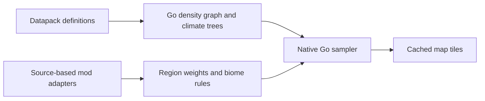

# Project Architecture

YoloMCL is a desktop launcher for Minecraft: Java Edition. A Go service manages game data and background work, while MyGo renders the native interface. The application runs as one executable.

## Repository layout

```text
main.go                  Application entry point
Makefile                 Build, check, packaging and release commands
cubiomes/                Pure-Go biome generation library and reference fixtures
internal/
  app/                   Process lifecycle and application assembly
  launcher/              Game instances, accounts, installation and background jobs
    memory/              Physical and available system memory
    proctree/            Game process trees and platform process attributes
    textenc/             Game log character decoding
    vault/               Account credential protection
  nativeui/              Native views, interaction state and presentation
    assets/              Embedded fonts, icons and images
  mcworld/               Read-only saved chunk and level metadata
  structure3d/           Structure assembly, layered assets and software rendering
  worldgen/              Structure randomness and versioned generation data
  i18n/                  Shared JSON translation catalogs and lookup helpers
  config/                Publisher identity and content-provider configuration
  buildinfo/             Build identity and update verification metadata
tools/                   Isolated Go developer commands and pinned check tools
scripts/                 Bash build, check, signing and packaging implementations
docs/                    Architecture, development and release documentation
build/                   Release packages
.cache/                  Local build and test outputs
```

## Package dependencies

```text
main -> app
app -> launcher, nativeui, buildinfo
nativeui -> launcher, buildinfo, i18n, cubiomes, structure3d, worldgen
launcher -> cubiomes, cubiomes/modjar, config, i18n, mcworld, structure3d, worldgen,
            launcher/{memory,proctree,textenc,vault}
cubiomes/modjar -> cubiomes
mcworld -> structure3d
structure3d -> worldgen
```

`app` and `nativeui` use MyGo. The launcher service is independent of the UI toolkit. The platform packages do not import their parent service or each other. `config`, `buildinfo`, `i18n` and `worldgen` use the standard library. Saved-world reading and structure rendering remain independent of both the launcher service and UI toolkit; the UI uses the renderer directly while file scanning and background jobs stay in the service.

`cubiomes` is a public, standard-library-only package with no launcher or UI
dependencies. It owns immutable noise/biome generators and worker-local sampling
scratch. The launcher owns file ingest, pack priority, coverage reporting,
structure eligibility, tile rendering and cancellation; see its [API and
benchmarks](../cubiomes/README.md).

Seed-map generation has two inputs to the same native engine. The datapack
compiler resolves effective registry definitions (including Terralith and
Tectonic). Source-based mod adapters translate injected behavior into shared
region, climate and biome-selection rules (including TerraBlender and BOP).
Adapters bind by verified version/content, dimension-type tags and local
configuration. Unknown executable mods do not silently reuse vanilla rules;
resource-only mods continue through the generic registry compiler.



`scripts/check-imports.awk`, invoked by `make check` and `make fmt`, checks these import boundaries.

## Application lifecycle

`main.go` passes command-line arguments to `app.Run` and reports startup errors. `internal/app/run.go` selects desktop, screenshot or diagnostic mode.

Desktop startup is coordinated by `internal/app/desktop.go`:

1. Configure the application name and supported languages.
2. Wait for MyGo's native application initialization, then begin font and image preparation.
3. Construct the launcher service and UI state, apply the renderer preference, and bind the system language.
4. Create the native window with `ui.View`, attach the UI lifecycle callbacks, and render the initial page.

MyGo manages window creation and rendering directly. Background scans use the UI's first-frame signal before starting deferred work. Screenshot and diagnostic modes have separate entry paths in `internal/app`.

The GUI dependency is pinned to upstream [MyGo v0.7.4](https://github.com/egoist/mygo/releases/tag/v0.7.4). Framework upgrades retain the renderer preference and pass native interaction and startup checks; no local MyGo fork is used.

New Windows configurations and Settings' restore-defaults action enable hardware acceleration. MyGo selects Direct3D 11, falls back to WARP when a hardware device cannot be created, and draws in memory if its GPU renderer cannot initialize or render. Disabling hardware acceleration selects the in-memory renderer on the next launch. Existing preferences are preserved, including older configurations that omitted the disabled flag; new saves record both enabled and disabled choices explicitly. An explicit `MYGO_GPU` environment variable overrides this preference. macOS and Linux retain their normal renderer selection.

## Launcher service

`internal/launcher.Service` owns configuration, account credentials, game processes, background jobs, content-provider clients and instance caches. The UI calls service operations and reads snapshots of their results. `api.go` dispatches named UI actions to service methods using JSON payloads.

| Area | Implementation | Responsibility |
| --- | --- | --- |
| Service and configuration | `store.go`, `config.go`, `roots.go` | Service initialization, configuration persistence, registered game directories and instance selection |
| Instance inventory | `inventory.go`, `version_scan.go`, `instance_status.go` | Cached snapshots, local version metadata, overview information and storage measurement |
| Game runtime | `runtime_options.go`, `minecraft.go`, `game_launch.go`, `game_process.go` | Runtime configuration inheritance, game dependencies, launch arguments and process supervision |
| Java | `java_scan*.go`, `java_catalog.go`, `javaget.go`, `java_managed.go`, `automemory.go` | Runtime discovery, download catalogs, managed installations and memory allocation |
| Installed content | `mods.go`, `modscan.go`, `mod_metadata.go`, `mod_install.go`, `mod_updates.go`, `assetpacks.go` | Mod metadata, enabled state, installation, updates, resource packs and shaders |
| Resource discovery | `providers.go`, `deps.go` | Modrinth and CurseForge queries, project versions and dependency resolution |
| Modpacks | `packs.go`, `pack_format.go`, `pack_import.go`, `pack_check.go`, `packupdate*.go` | Import, manifests, installation checks, update plans, backups and rollback |
| Accounts | `auth.go`, `auth_microsoft.go`, `auth_yggdrasil.go`, `authservers.go` | Shared account lifecycle, offline profiles, Microsoft authorization, Yggdrasil authentication and authentication servers |
| Worlds | `worlds.go`, `world_nbt.go`, `world_backup.go` | World summaries, NBT metadata, backups and restoration |
| Seed maps | `worldgen*.go`, `seedmap_*.go`, `cubiomes/` | Read-only worldgen ingest, library-backed noise/climate and biome lookup, biome-filtered candidates, bounded CPU tiles and caching; see [coverage](seed-map.md) |
| Sessions and logs | `sessions.go`, `playstats.go`, `logtail.go`, `loginsight.go` | Game sessions, play history, log reading and crash information |
| Instance media and preferences | `addonicons.go`, `game_options.go`, `cosmetics.go`, `serverstatus.go`, `recentserver.go` | Local icons, game options, skins, capes and multiplayer server information |
| Service helpers | `data_migrate.go`, `language.go`, `net_fault.go` | Data-directory migration, system-language normalization and per-client network fault simulation |

`Snapshot` combines current settings, accounts, jobs and running versions with cached instance inventories. Inventory refreshes watch known Minecraft metadata and are invalidated by operations that change the instance. The overview loads basic information separately from storage totals so directory walks do not delay its first result.

`status_cache.go` reuses storage totals for up to 30 seconds during navigation; repeated reads do not extend that lifetime. Expired totals are recalculated on the next request, and the overview's refresh action always scans again. Cache invalidation and scan generations prevent late workers from replacing newer totals. No periodic storage walk runs while the interface is idle.

Overview validation and summary loading share one directory enumeration per request. Counts use entry names and types; screenshots, logs and saves also use their metadata. Windows file attributes returned by directory enumeration are reused instead of querying each file again. The cache retains a compact digest and summary, while directory entries are released after the request. Superseded requests stop during validation and cannot overwrite newer summaries.

Mod scans reuse per-instance metadata and file hashes from `.mcl/modcache.json` when file size and modification time match. New or changed files provide loader IDs, versions and dependency declarations through their JSON/TOML archive entries. Modrinth and CurseForge metadata supplement local records with project details and available updates; they do not replace the installed file's dependency declarations.

Install previews traverse the provider-declared required dependency graph across all levels, including the exact versions of installed or disabled intermediate mods. Version-only references are resolved to project IDs before deduplication; imported files can be identified by hash or fingerprint. Preview and installation share version compatibility checks, detect cycles and conflicting pinned versions, and reject graphs exceeding 128 projects instead of reporting a truncated graph as complete. Missing descendants are included in the install plan without downloading an already satisfied intermediate mod again. Every required parent is retained so that selecting optional extras also selects their required descendants, while unchecked branches stay inactive and shared dependencies remain selected through their other parents.

`mod_cache.go` bounds each instance's metadata cache to 4 MiB and streams its entries to disk. `mod_metadata_cache.go` maintains a shared SHA-1 index in `cache/mod-metadata.bin`, limited to 8 MiB and 4,096 records. It stores metadata and CurseForge fingerprints, with no JAR contents or artwork. Only an offset directory is loaded while scans or installations are active; the last user closes the file and releases that directory. Batched compaction evicts the oldest inserted records. Checksums and length limits make corrupt or interrupted records cache misses.

Mod and modpack installation reuse verified download hashes and populate metadata caches before reporting completion. Pack overrides invalidate the corresponding download identity. The settings page reports metadata cache storage and clears both shared and per-instance files in a background operation. A generation check prevents pre-clear work from republishing stale caches; mods, installation records and backups are preserved.

Concurrent cold scans share a temporary workspace: six workers hash files, at most two parse ZIP directories, and one reusable buffer handles medium compressed nested JARs. Outer JARs above 256 KiB use 64 KiB streaming reads. Small nested JARs use worker-local scratch space, stored nested JARs use direct section reads, and medium compressed entries share at most a 4 MiB reusable buffer. Larger nested entries, up to the 16 MiB parsing limit, use temporary files and a 64 KiB copy buffer; those files are closed and removed when reading finishes or is cancelled. Unavailable temporary storage falls back to a serialized, non-retained allocation. Cancellation interrupts buffer waits, archive reads and decompression. The workspace becomes unreachable when its final scan finishes; dependency previews use the same cancellation path.

## Native interface

`internal/nativeui.App` owns the view tree and interaction state. `app_state.go` groups page state, request generations, caches and lock-protected fields. `selection.go` synchronizes instance selection with service snapshots.

| Area | Implementation | Responsibility |
| --- | --- | --- |
| Application shell | `app.go`, `shell.go`, `navbar.go`, `titlebar.go` | Window attachment, navigation and application lifecycle |
| Visual resources | `assets.go`, `images.go`, `theme.go`, `tokens.go` | Embedded and remote images, fonts, colors, surfaces, spacing and dimensions |
| Text and controls | `typography.go`, `display_text.go`, `page_widgets.go`, `buttons.go`, `select_widgets.go`, `vertags.go` | Text layout and formatting, shared controls and version badges |
| Instances | `overview*.go`, `instance*.go`, `addons_*.go`, `addon_*.go` | Instance navigation, overview, installed content and content actions |
| Discovery and installation | `discover*.go`, `project_*.go`, `install_*.go`, `game_install_dialog.go`, `import_dialog.go`, `drop.go` | Provider searches, version filtering, dependency previews and installation dialogs |
| Accounts and wardrobe | `account_*.go`, `authserver_dialog.go`, `wardrobe*.go`, `skin.go`, `avatar.go`, `skin_defaults.go` | Account actions, appearance loading and upload, model rendering and default skins |
| Settings and Java | `settings*.go`, `java_settings.go`, `java_installed.go`, `runtime_dialog.go`, `javaget_ui.go`, `about.go` | Settings drafts, runtime scanning and selection, Java downloads and build information |
| Worlds and modpack updates | `worlds_ui.go`, `packupdate_ui.go`, `packchanges_ui.go` | World management and modpack update review |
| Seed map preview | `seedmap*.go` | Map search workspace, bilingual structure icons, saved/estimated spawns, pan/zoom, coverage badges and generation-checked MyGo bitmap updates |
| Tasks and logs | `tasks.go`, `task_*.go`, `log_state.go`, `log_loading.go`, `logview.go`, `logpanels.go`, `log_layout.go`, `logsessions.go` | Task progress, log state, asynchronous reads and log navigation |
| Feedback and motion | `error_text.go`, `notices.go`, `empty_state.go`, `motion.go`, `content_motion.go`, `number_motion.go`, `scrollbar.go` | User-facing errors, notifications, empty states and shared transitions |

`i18n` loads English and Chinese text, provider categories, task progress and crash explanations from `internal/i18n/locales/*.json`. The JSON files are embedded and decoded once; views use message keys or the typed `Copy` fields. Missing entries inherit English, and explicit empty strings stay empty. Both the launcher and UI share this standard-library-only package. See [Translation guide](i18n.md) for editing and validation. `log_parse.go` converts plain-text and Log4j XML output into displayable log entries. `skin_defaults.go` caches the embedded Steve and Alex textures.

Artwork uses a shared LRU cache capped at 256 aliases and a 16 MiB estimated memory budget, including bitmap mip levels. Identical encoded images at the same decode size share one resource across jar versions, paths and URLs. The content index holds only resources still referenced by the LRU; removing the last alias releases its pixels and index entry. Cache hits skip decoding and resizing. Raster icons retain up to 128 pixels, add-on thumbnails up to 96 pixels, and screenshot previews up to 960 pixels. Two icon workers and one screenshot worker limit simultaneous decoding, and overview preloads share in-flight requests with visible widgets. Remote originals remain in the disk cache so evicted artwork can be loaded again without a network request.

Discover retains its results, including completed empty searches, and scroll position for one minute after navigation away. Returning cancels the eviction. Otherwise a single timer releases results, card state and artwork that other pages have not reused, cancels pending searches and invalidates late responses. Unused bitmaps also drop their pixel storage through MyGo's public API after pending decoders finish, so layout scratch cannot keep old covers resident. Search and filter selections remain available for reloading on the next visit. Released allocations are reclaimed by idle maintenance after rendering and active jobs settle.

The Chinese name index packs each translated name and its platform slugs into one string, with integer offsets for lookup. Mod IDs share a contiguous table; provider-specific duplicate rows retain independent ID ranges. The index remains available for instant navigation without reparsing CSV data.

Motion follows the element's role. Overview panels, secondary readouts, dates, hero content, newly loaded instance data and ordinary discovery cards fade in place. Only the four large overview statistics use rolling digits. Navigation indicators slide to the selected item; tab navigation retains a short horizontal transition, filtering can expand new discovery cards, and storage segments animate their proportions. Card surfaces, reading baselines and action targets remain stationary during data refreshes. Unchanged data does not replay animations, and reduced-motion preferences bypass them.

The interaction patterns were checked against [CrychicUI](https://github.com/ELY-Open-Source/CrychicUI), which also targets MyGo v0.5.5. Instance pages and game setting categories share `underlineTabs`, with a sliding indicator, arrow/Home/End navigation and immediate content selection. Storage segments preserve byte proportions, show category/size/percentage tooltips, share highlights with their legend and open the corresponding category; the existing overview transition guard prevents actions on outgoing instance data. Cold settings/backup reads and overview placeholders use a subtle skeleton sheen adapted from CrychicUI's `feedback/Skeleton` (MIT, attribution and license embedded). Loading preserves existing settings drafts and cached storage when available. Skeletons stop requesting paint frames when absent or under reduced motion. These components use the existing MyGo APIs and JSON localization; the default lift/entrance wrappers and synthesized click sounds are not imported.

## State and asynchronous work

Service configuration is protected by `Service.mu`. Mutating operations copy the configuration, validate the draft and write it atomically before publishing the new state. Returned configuration and version maps are copied rather than shared with callers.

UI state is updated on the UI thread. Workers carry a cancellation context and request identity, then return results through `App.post`. The native window's main-thread update callback drains the result queue even when the window is hidden or minimized, so cleanup does not depend on painting. Rendering also drains queued results before building the view. Request generations prevent results from a previous instance, account, project or version from replacing the current view. Instance selection reuses cached data; system Java discovery has its own scan lifecycle.

`app_background.go` polls snapshots every 450 milliseconds during active jobs, every two seconds while idle, and every five seconds while hidden or minimized. UI operations wake the worker early, with bursts coalesced. Only changes to data, selection generation or system language wake the view. The change digest compares modpack locks and update results by their immutable inventory publication rather than re-encoding their file lists and changelogs on each poll. System memory is queried outside `Service.mu`; macOS reads physical memory once and reuses `vm_stat` samples for five seconds. Inventory checks run every five seconds while visible and every thirty seconds in the background; restoring the window requests an immediate check.

`inventory_monitor.go` owns the directory watchers for that maintenance worker. On fixed Windows volumes, one change-notification handle per root replaces repeated metadata probes while files are unchanged. Metadata validation runs after changes, explicit invalidation, or a five-minute fallback deadline. Root identity checks detect replacement, and notifications survive coalesced or concurrent scans until validation actually runs. Other platforms and unsupported volumes retain timed metadata checks. Removing a root or stopping the worker closes its notification handles; the monitor keeps no extra inventory cache.

The live log view polls the selected session once per second but parses lines only after the session's ring receives output or its running state changes. Parsed lines share one copy of their message text, and wrapped-height measurements are keyed by content hash. Game output is written to the session log once per pipe read, and selecting the already-active instance, version or account does not rewrite `config.json`. Overview and world-size results are reused while their input file stamps are unchanged; `level.dat` parsing is bounded and skips unneeded payloads while reading save metadata, seeds and enabled datapacks. Automatic memory shown in snapshots uses total memory and the installed mod count, while launch still checks memory available at that moment.

Animations and time-dependent controls schedule their own frames. The wardrobe caches model geometry and decoded texture pixels, uses channel shading lookup tables, and alternates two frame buffers with a shared depth buffer. Continuous automatic rotation runs at thirty frames per second; dragging, zooming and short orientation transitions retain their interactive cadence.

Account avatars use `launcher/account_skin.go` to load only public profile skin textures; Microsoft avatars do not require login-token refresh, authenticated wardrobe data, or cape downloads. Validated skin textures are cached per account/provider under `cache/account-skins`, allowing the last head to display immediately during refresh or an outage. The UI bounds concurrent requests, retries failures with backoff, cancels work on invalidation/shutdown, and rejects stale completions after skin changes. Wardrobe uploads and ownership-sensitive operations continue to use the authenticated appearance flow.

After three seconds without a frame or active task, `memory.go` can reclaim temporary Go heap allocations and return unused pages to the operating system. Reclamation happens once per idle period, normally thirty seconds apart; large allocation bursts may use a ten-second cooldown. Live caches and GPU rendering remain available.

Background installation updates its target instance without changing the user's active selection. Modpack updates retain backups and restore files when application or persistence fails. Rollback failures retain the backup for another attempt.

Network operations use the service's HTTP clients. Resource requests support cancellation, timeouts, response limits and redirect checks. File parsers apply size and depth limits; content scans stay within registered Minecraft data and launcher-owned paths.

## Configuration and storage

Game setting inheritance manages existing entries in the game's `options.txt`. Global `config.json` stores vanilla key overrides in `keyBindings` and video, audio and mouse defaults in `gamePreferences`; definitions and display units come from `launcher/keybindings_catalog.json` and `game_preferences_catalog.json`. Each actual game directory stores its own `bindings` and `options` in `.mcl/keybindings.json`. The order is modpack override, global vanilla/default override, then the game's original value. Isolated version directories remain independent; versions sharing a game directory also share its profile. The editor groups bindings by mod and provides direct key recording, typed bindings, numeric fields, sliders and setting switches without per-row enable toggles. Editing creates an override; reset returns to inheritance. One save applies the pack's keys and settings together under the root lock. Saved profiles also apply immediately before launch, while no game in the root is running. A first run without `options.txt` is left to Minecraft to initialize; only existing keys are patched on a later launch.

`launcher/keybindings.go` preserves unrelated options, BOM and line endings, and translates canonical key names to legacy numeric codes when needed. `game_preferences.go` validates types and ranges and writes integer settings as integers. Instance editors expose additional existing options for direct text editing; version metadata, resource-pack lists and the last server are excluded. Manual saves and applications check a revision covering both scopes and the file. `.mcl/keybindings-state.json` tracks original and applied values, including a pending transaction, so removing an override restores the original value without discarding newer game edits. Atomic replacement and `.mcl/keybindings-options.bak` protect the options file independently of modpack backup retention. User-visible text and action labels live in the JSON locale catalogs.

Mod binding names are resolved from installed resources rather than a hardcoded translation table. `launcher/keybindings_labels.go` matches each existing options key (without its leading `key_`) against `zh_cn`, `zh_tw`, and `en_us` resources in enabled mod JARs, legacy version-specific mod folders, and the active resource packs listed in `options.txt`. The scanner supports modern JSON, legacy UTF-8 `.lang`, Forge's explicit properties-escape marker, and bounded nested JARs. Enabled ZIP and directory resource packs override JAR translations in game priority order. Lightweight Fabric, Quilt, Forge, NeoForge, and legacy manifests supply mod names where available. The editor shows Chinese, then English or the raw identifier when a name is unavailable, retains the exact identifier for disambiguation, and searches across all collected languages and mod names. English UI prefers the English name. Filters separate vanilla, mod, and missing-Chinese controls. Options do not include the game's keybinding categories, so the editor reports mod/resource namespaces rather than guessing those categories.

The editor first reads editable settings through `ReadKeyBindingValues`, without opening mod archives. A separate cancellable worker fills in translated labels; it never disables editing or saving, replaces drafts, or applies results after the dialog is closed/reloaded. Saves also return only values, retaining already resolved labels. Language scanning is bounded and read-only. A service-local cache retains matching labels for four recent packs and invalidates on changed source paths, sizes, modification times, active-pack order, or action identifiers. Returned maps are cloned. Corrupt, unreadable, or oversized resources leave actions editable and mark the result incomplete; those scans are not cached. Translations never enter binding profiles or replace stable options identifiers. Mods with dynamically generated names or no shipped translation fall back to available names or identifiers; actions absent from `options.txt` require Minecraft to register and save them first.

The frame-rate endpoint uses a catalog-defined localized maximum label: 260 is displayed as unlimited but remains 260 in game files. Integer display steps, including mouse sensitivity in 1% increments, are enforced in the editor without rewriting inherited fractional game values just by reading them. Save progress and success appear inside the settings dialog.

`game_settings_backups.go` and `game_settings_restore.go` provide manual snapshots, automatic copies before saves/restores, and revision-checked restoration. Pack snapshots in `.mcl/settings-backups/` contain the exact options bytes, override profile, and resolved application journal; global snapshots in the launcher data directory's `game-settings-backups/` contain only game defaults, never accounts or other launcher settings. The latest 20 automatic copies are retained; manual copies are not pruned. The editor's Backups tab confirms restoration, supports a missing `options.txt`, and replaces the draft after success. Root mutations exclude running games, reject stale revisions and invalid backup paths, and attempt to roll back all three pack files on an IO failure. The pre-restore snapshot remains available for undo or recovery.

- `internal/config` reads publisher-owned Microsoft and CurseForge configuration from build-injected values and supported environment overrides. `dotenv.go` parses the supported fields for runtime `.env` overrides; build scripts read the repository-root `.env` when injecting publisher configuration.
- Player preferences, accounts and registered instance configuration are persisted by `internal/launcher` in the launcher data directory. `MCL_DATA_DIR` can select that directory.
- Instance inventories and downloaded resources are cached under launcher-managed storage. Minecraft files and modpack metadata remain in their game directories.
- `internal/buildinfo` exposes build identity and the embedded update public key. It verifies signed minimum-version policies and persists the latest verified policy beside launcher settings.

## Platform services

| Package | Platform implementation |
| --- | --- |
| `launcher/memory` | Physical and available memory on Windows, macOS and Linux |
| `launcher/proctree` | Windows Job Objects and Unix process groups for game-process lifetime management |
| `launcher/textenc` | UTF-8, GB18030 and platform code-page decoding for game output |
| `launcher/vault` | Windows DPAPI for stored account tokens; other platforms return an unsupported-operation error |

Java auto-download currently targets Windows amd64. Platform-specific implementations and tests live in the corresponding package or OS-constrained files.

## Build and release pipeline

| Command | Implementation | Output |
| --- | --- | --- |
| `make build` | `scripts/build.sh` | Launcher executable with injected publisher and build metadata |
| `make fmt` | `scripts/check.sh` | Formatted source and import-boundary validation |
| `make check` | `scripts/check.sh`, `scripts/test.sh` | Formatting, dependency verification, static analysis, Shell regression checks and Go tests |
| `make release TAG=vX.Y.Z` | `scripts/release.sh`, `scripts/release-lib.sh` | Platform archives, signed update manifests and checksums |
| `make verify TAG=vX.Y.Z` | `scripts/release.sh` | Verification of all six platform artifact sets |

`tools/go.mod` and `tools/go.sum` pin `goimports`, `staticcheck` and the Go developer commands independently of launcher dependencies. `tools/cmd/` contains data generation, C/Go benchmark orchestration and the wordmark font subsetter; shared file helpers live in `tools/internal/`. These commands are covered by the regular project checks. `scripts/lib.sh` supplies literal configuration parsing and Git build identity; archive tools and OpenSSL handle packaging and signatures. See [developer tool usage](../tools/README.md).

Release versions come from an existing Git tag on a clean checkout. The Release workflow runs checks on Windows, macOS and Linux, builds amd64 and arm64 packages, verifies every artifact set, and publishes the GitHub release. macOS bundles are ad-hoc signed on macOS before their update archives are signed.

The launcher checks the latest stable release's platform manifest once per start and presents an update confirmation. `scripts/update-policy.conf` supplies the minimum supported version; packaging signs that policy separately for each platform. `launcher_update*.go` verifies and caches the policy, queues optional prompts, and restricts retired versions to updating or exiting. MyGo's updater verifies and installs the archive. Release archives contain application files and licenses; player settings and Minecraft data stay in their existing storage locations.
